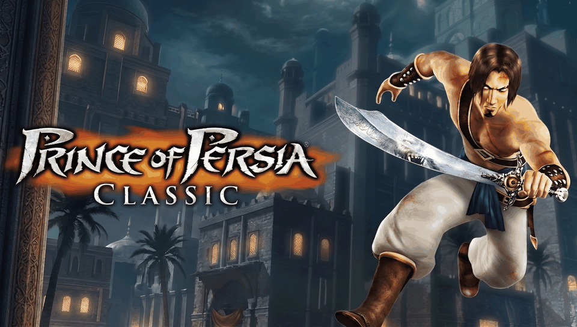

<h1 align="center">
  <br>
  Prince of Persia Classic · PS Vita Port
</h1>

<p align="center">
  <b>Native port of Prince of Persia Classic (Ubisoft) for PlayStation Vita and PlayStation TV.</b>
</p>

<p align="center">
  
  
  
  
  
  
</p>

<p align="center">
  <a href="#-description">Description</a> •
  <a href="#-features">Features</a> •
  <a href="#-controls">Controls</a> •
  <a href="#-installation">Installation</a> •
  <a href="#-known-issues">Known Issues</a> •
  <a href="#-building-from-source">Build</a> •
  <a href="#-credits">Credits</a> •
  <a href="Docs/README_ES.md">Versión en Español</a>
</p>

---

## 📖 Description

Prince of Persia Classic is a 2012 release for Android and iOS devices that recreates the levels of the legendary 1989
classic game with modernized 3D graphics. It is built on Cocos2d-x.

This repository contains a **wrapper/loader** for the Android version of Prince of Persia Classic. It adapts the environment to run
the game's native ARM dynamic libraries (`.so`) on the PS Vita, using TheFloW's Android SO Loader base (soloader) and FalsoJNI.
The game's own files are not included: you provide them.

This is my first PS Vita port and my first homebrew project of this scale. See [Beta Testing / Contributing](#-beta-testing--contributing)
below. I could really use the help.

### ⚖️ Legal & DMCA

**Prince of Persia Classic** is the intellectual property of Ubisoft Entertainment.
This repository does **NOT** contain any original code, executables, protected binaries, or game assets. It strictly provides the
open-source "wrapper" code. The included LiveArea assets are AI-generated or open-source images, free from copyright restrictions.
On-screen text is currently rendered with a bundled open-source font ([DejaVu Serif](https://dejavu-fonts.github.io/), Bitstream Vera
license) instead of the game's original typeface. See [Known Issues](#-known-issues).

To play the game, you MUST possess a legitimate, legally obtained copy of the Android game. Users must manually extract and provide
their own files (the `.so` libraries, plus the game's data, either as `.apk` / `.obb` or as the equivalent files extracted loose; see
step 5 of [Installation](#-installation)). None of that copyrighted content is tracked in this repository. See `.gitignore`
(`*.so`, `*.apk`, `*.obb`, `*.suprx`, `ux0_data/`, `original/`, `bin/`).

---

## 🎮 Status & Playability

**Status: Playable (beta) (v01.55)**

The port is early and actively developed. Touch, walking, jumping and crouching were confirmed on real hardware from the first
baseline (v01.00). Later builds record further console confirmations, such as cutscene audio and FPS (v01.19), Simplified Chinese
text (v01.50), and native trophies and the coin store (v01.55). Known open issues are listed below.

- [x] **Gameplay end to end**: touch, walk, jump and crouch confirmed on real hardware (v01.00 baseline).
- [x] **Audio**: custom mixer over `sceAudioOut` (BGM and SFX).
- [x] **Cutscenes**: SceAvPlayer video with correct cutscene audio. Confirmed on real hardware in v01.19.
- [x] **Native PS Vita trophies (v01.55)**: installed on first launch, notification confirmed on console.
- [x] **Coin store (v01.55)**: potions and revives bought with in-game coins (per the v01.55 release notes).
- [x] **Simplified Chinese text (v01.50)**: confirmed on console.
- [ ] **Remapping overlay FPS option**: the FPS counter and FPS limit are new and not yet tested on console.
- [ ] **Open items**: D-Pad running and the action-loop bug (see Known Issues).

### 📋 Version history

The full version history (v01.00 to v01.55, in Spanish and English) is in [`Docs/CHANGELOG.md`](Docs/CHANGELOG.md).
Per-release notes are in `Docs/RELEASE_v01.*.md`. Technical details of each fix are in [`Docs/Fixes_Log.md`](Docs/Fixes_Log.md).

### 📦 Release notes (v01.55): Native Trophies & Coin Store

**PS Vita trophies now install and unlock, and potions and revives are bought with coins earned in-game.**

- **Native PS Vita trophies**: 18 trophies (17 + Platinum). They install the first time you launch the game, and the system
  notification pops when you earn one. Requires `NoTrpDrm.suprx` under `*main` (see Installation).
- **Store without real money**: life potions and revives are bought with coins, and coins are earned by playing: each score point
  = 1 coin. They are credited when the main menu or the pause menu opens. Only your best score per level counts. Real-money
  (Google Play) purchase screens no longer appear; they take you to the coin-based lives store instead.
- **Installation**: install `popclassic.vpk` with VitaShell (save data is kept).

---

## ✨ Features

| Feature | Status | Notes |
| :--- | :---: | :--- |
| Boots to gameplay | ✅ | Gameplay end to end confirmed on hardware from v01.00. |
| Graphics / renderer | ✅ | vitaGL. Video colour and LUT fixes in v01.18. FPS improved in v01.19 (confirmed by the user). |
| Audio & music | ✅ | Custom mixer over `sceAudioOut` for BGM and SFX. |
| Video / cutscenes | ✅ | SceAvPlayer playback. Cutscene audio confirmed in v01.19. Skip with Cross or Start. |
| Physical buttons | 🟡 | Physical mapping with the game's own gamepad path (v01.28). D-Pad running is an open item. |
| Analog sticks / camera | 🟡 | Analog stick calibrated (v01.17). Deadzone is adjustable in the remapping overlay. |
| Touch screen | ✅ | On-screen controls and menu navigation. |
| Button remapping / port menu | 🟡 | START + SELECT overlay: remap, deadzone, HUD toggle. The FPS counter and limit are not yet tested on console. |
| Save data | 🧪 | Saves in `save/`. Keeping saves across installs is by design (same Title ID); not separately verified. |
| Native trophies | ✅ | 18 trophies. Install and notification confirmed on console (v01.55). |
| Languages | ✅ | Simplified Chinese confirmed on console (v01.50). Other localizations load from `Data_960_576/Localization`. |
| Performance | 🟡 | FPS improved in v01.19 (confirmed by the user). No measured numbers in the port notes. |
| Online / IAP / ads | ➖ | No network features. Real-money purchase screens are redirected to the coin store (v01.55). |
| PS TV | 🧪 | DualShock 3/4 controller mapping is supported. Not tested yet. |

Legend: `✅ Working (verified on console) · 🧪 Implemented, not yet verified on console · 🟡 Partial · ❌ Not working · ➖ Not applicable · ❔ Not documented yet`

---

## 🎯 Controls

The port includes a full physical controls remapping system and an in-game configuration overlay.

### In-game remapping menu

- Press **START + SELECT** together at any time to open the remapping overlay.
- Navigate with D-Pad Up / Down.
- Press **Cross** to replace a button binding, **Square** to add a secondary button binding, or **Triangle** to unbind.
- Adjust **Analog Stick Deadzone** (left / right to calibrate).
- **FPS Counter** (top-left) and **FPS Limit** (Off / 30 FPS), saved in `config.txt`. *(new, not yet tested on console)*
- **L + R** shows or hides the on-screen touch controls (remappable as `TOGGLE_HUD`).
- Supports Vita physical buttons, PlayStation TV controllers (DualShock 3/4 with native L2 / R2), and PS Vita Rear Touch
  quadrants (`L2`, `R2`, `L3`, `R3`).
- Bindings are saved automatically to `ux0:data/popclassic/controls.txt`.

### Default controls

| Button | Platform mode | Combat mode |
|:---:|:---|:---|
| Left Analog Stick / D-Pad | Move Prince: tap for one careful step, **hold to run** | same |
| Cross | **Jump** | Attack |
| Square | Crouch | **Defend / parry** |
| Triangle | Interact (grab, levers) | Sheath sword |
| Circle / Down | Crouch / Roll | — |
| Up | Jump / climb | — |
| Start | Pause Menu (Android `KEYCODE_BACK`) | Pause Menu |
| Select | Menu (Android `KEYCODE_MENU`) | Menu |
| Start + Select | **Open Controls Configuration Overlay** | same |
| L + R together | Show / hide the on-screen touch buttons | same |
| Cross / Start | Skip cutscene (during video playback) | — |
| Touchscreen | Still works for menu navigation | — |

> Coming from v01.20 or earlier: **Square used to be a "walk" modifier and is now crouch / defend.** Walking no longer needs a
> modifier. Full details in [`Docs/RELEASE_v01.28.md`](Docs/RELEASE_v01.28.md).

---

## 🏆 Trophies

18 native PS Vita trophies (17 + Platinum), linked to the game's achievements through `SceNpTrophy`. They install on the first
launch and pop the system notification when unlocked (confirmed on console in v01.55).

- Requires `NoTrpDrm.suprx` under `*main` in `ur0:tai/config.txt`, and a reboot after editing it (see Installation, step 2).
- The trophy pack is `TROPHY.TRP`. In v01.55 its signature and icons were regenerated (320-character signature, 8-bit PNG icons,
  1.69 MB → 332 KB), because the console rejected the earlier pack with `NP-6185-0`.
- Icons were processed with Real-ESRGAN (4x super-resolution), corrected for orientation, and have no artificial frames (v01.40 notes).
- Technical details: [`Docs/Fixes_Log.md`](Docs/Fixes_Log.md) §28 (v01.40) and §38–39 (v01.55), as referenced in [`Docs/CHANGELOG.md`](Docs/CHANGELOG.md).

---

## 📋 Prerequisites

To run this port on your PS Vita or PS TV, you will need:

1. A console running Custom Firmware that allows signed homebrew (**Enso**, HENkaku / h-encore², etc.; firmware 3.60 / 3.65, or the
   currently supported h-encore² range).
2. The **kubridge**, **FdFix** and **NoTrpDrm** plugins (see Installation).
3. `libshacccg.suprx` (Sony's shader compiler). You can obtain a legitimate copy from your own console using the ShaRKBR33D
   homebrew. It can never be redistributed, so it is **not** included in this repository (`.gitignore`: `*.suprx`).
4. A legally obtained copy of the Android game, from which you extract the data described in Installation.

---

## 📦 Installation

### Choosing a VPK: Debug vs. Play build

This project can produce two different VPK builds from the same source, controlled by the CMake option `ENABLE_VERBOSE_LOG`:

| Build | CMake flag | Use it for | Notes |
|---|---|---|---|
| **Play** (recommended) | `-DENABLE_VERBOSE_LOG=OFF` (default) | Actually playing the game | Best performance, no logging overhead. |
| **Debug** | `-DENABLE_VERBOSE_LOG=ON` | Reporting a bug / helping test | Writes a detailed, timestamped trace (module loads, JNI calls, audio / video / scene events) to a log file on the memory card, at the cost of extra I/O and occasional FPS drops. |

If you're not sure which one you need: install the **Play** build. Only switch to the **Debug** build if something is going wrong
and you want to grab a log file to attach to a bug report.

### Steps

To install the port on a real PS Vita:

1. Ensure your console is running a CFW that allows signed homebrew (see Prerequisites).
2. Install the **kubridge**, **FdFix**, and **NoTrpDrm** plugins by adding them to your `config.txt`:
   ```ini
   *KERNEL
   ur0:tai/kubridge.skprx
   ur0:tai/fd_fix.skprx

   *main
   ur0:tai/NoTrpDrm.suprx
   ```
   > ⚠️ **Important for trophies**: `NoTrpDrm.suprx` is required under `*main` for the console to install and pop native PS Vita
   > trophies without DRM errors (`NP-6185-0`). Be sure to reboot the console after editing `config.txt`.
3. Install `libshacccg.suprx` (see Prerequisites).
4. Install the generated `.vpk` (see the table above for Debug vs. Play).
5. Obtain your own legal copy of the Android game. Extract its data and lay it out on the console under `ux0:data/popclassic/`
   with **exactly** this structure. `original.apk` and the `.obb` are **not needed at all**; just the loose files below:
   ```
   ux0:data/popclassic/
   ├── libcocos2d.so
   ├── libcocosdenshion.so
   ├── libgame_logic.so
   ├── appConfig.txt                 <- required (either here or inside Data_960_576/)
   ├── controls.txt                  <- optional: custom controller mapping (auto-generated)
   ├── save/                         <- empty folder, the game writes its saves here
   ├── logs/                         <- only used by the Debug build; created automatically if missing
   ├── Data/
   │   ├── Audio/                    <- Ambiance/, Music/, SFX/ (mirrors the game's own folder layout, .mp3 files)
   │   ├── font/                     <- .ttf files, flat (no subfolders)
   │   └── Video/Mid/                <- cutscenes as .mp4, flat (no subfolders)
   └── Data_960_576/                 <- Animations, Effects, Localization, Logo, Maps, Particles, Texture, appConfig.txt
   ```
   > Everything the game needs is served loose from the memory card. The engine's own file-loading function used to route *every*
   > relative-path request straight into the `.apk` / `.obb` ZIP with no loose-file check, unlike textures / maps / animations, which
   > already worked loose. The port now hooks that function to serve a loose file for anything, so the `.apk` / `.obb` are never
   > consulted as long as `Data_960_576/` (with `Localization/` and `appConfig.txt`) is present. You can still point it at
   > `original.apk` / the `.obb` instead if you'd rather not extract the full loose tree. Both paths remain supported; the hook falls
   > back to them automatically if a loose file isn't found. See [`Docs/Fixes_Log.md`](Docs/Fixes_Log.md) #19 for the technical detail.
6. Extract the three native libraries from the `lib/armeabi/` (or `lib/armeabi-v7a/`) folder of your `.apk` and place them directly
   under `ux0:data/popclassic/` as shown above:
   * `libcocos2d.so`
   * `libcocosdenshion.so`
   * `libgame_logic.so`

For a full step-by-step FTP transfer walkthrough (using VitaShell), see [`Docs/en/INSTALL_HARDWARE.md`](Docs/en/INSTALL_HARDWARE.md).

*(Note: check community forums for patching scripts and tools to prepare your legal APK / OBB files, or extract the equivalent loose
folder structure directly.)*

---

## 🐛 Known Issues

This is an early, actively-developed port. Read this list before reporting a bug. It may already be a known or tracked issue (see
[`Docs/Fixes_Log.md`](Docs/Fixes_Log.md) and [`Docs/plan_portabilidad.md`](Docs/plan_portabilidad.md) for the full technical history).

- **Open gameplay items**: D-Pad running and the action-loop bug are still being investigated. Jump combined with walking was
  under investigation in v01.21 to v01.28 (see `Docs/CHANGELOG.md`). Real gameplay logs are welcome.
- **Not using the game's official fonts yet**: Sony's native font APIs (`ScePvf` / `ScePgf`) aren't implemented on Vita3K, and pulling
  in the original Android font assets raised licensing questions. Text is rendered with the open-source, freely licensed
  **DejaVu Serif** font via `stb_truetype`. On-screen text would look closer to the original Ubisoft style with the real font.
- **Not compatible with Vita3K (emulator)**: this is a bug in Vita3K itself, not in this port. The menu, text and audio work, but
  starting a real game ("New Game" / "Quick Game") crashes because Vita3K's renderer mishandles non-power-of-2 swizzled textures
  (reproduced 3/3 times, and still present on Vita3K's `master` at the time of testing). **This port targets real PS Vita hardware.**
  Technical details in `Docs/plan_portabilidad.md` §9.17.
- **Exit crash fix**: selecting "Yes" in the in-game Exit dialog used to crash instead of returning cleanly to the LiveArea
  (`Cocos2dxActivity_terminateProcess`). This is fixed.
- **Chinese text fallback**: the game's Chinese font lacks 198 of the 700 characters of `Localization/Chinese`. A glyph fallback
  (`NotoSerifSC-Subset.otf`, Noto Serif SC subset, SIL OFL) fills them in (v01.50).
- **Logs**: the Debug build writes a trace to `ux0:data/popclassic/logs/`. The Debug build also streams its log live over UDP
  (broadcast to port 9999), so `psvita-toolkit logs-live` can read it. Crash dumps are written by the system to `ux0:data/`.

As of the current build (v01.55), controls remapping, exit crash fixes, full Simplified Chinese text, native trophies and the coin store
are functional.

Found something not on this list? Please open an issue. See [Beta Testing / Contributing](#-beta-testing--contributing).

---

## 🔨 Building from Source

You need the PS Vita SDK compiled with `softfp` support:

```bash
git clone https://github.com/vitasdk-softfp/vdpm
```

Development workflow used for this port:

1. **Set up the toolchain.** Install `vitasdk` (softfp) and export `VITASDK` to point to it.
2. **Clone this repo** and, to run it on your own hardware, rebuild the `ux0_data/popclassic/` asset tree from your own legal APK / OBB
   (see [Installation](#-installation)). This folder is gitignored and never shipped.
3. **Build.**
   ```bash
   cmake -S. -Bbuild -DCMAKE_BUILD_TYPE=Release -DENABLE_VERBOSE_LOG=OFF
   cmake --build build
   ```
   This generates `build/popclassic.vpk` (the `VITA_VPKNAME` in `CMakeLists.txt`; older builds from v01.11 to v01.19 were named
   `popclassic_audio.vpk`). See [Known Issues](#-known-issues) regarding real gameplay on Vita3K.
4. **Deploy to real hardware over FTP with VitaShell.** Iterate on just the `eboot.bin` (no full reinstall needed per change). Full
   walkthrough in [`Docs/en/INSTALL_HARDWARE.md`](Docs/en/INSTALL_HARDWARE.md).
5. **Debug.** Build with `-DENABLE_VERBOSE_LOG=ON` for a detailed trace log on the memory card. If the game crashes with no dialog,
   use the `dump` CMake target (`make dump`) to pull a core dump over FTP and symbolize it against `build/so_loader.elf` with
   `vita-parse-core`.
6. Check [`Docs/CHANGELOG.md`](Docs/CHANGELOG.md) and [`Docs/Fixes_Log.md`](Docs/Fixes_Log.md) before starting work on a bug. There's
   a good chance it's already been investigated.

## 📁 Project Structure

- `source/`: loader, JNI bridge, audio mixer, video, controls, trophies and the logger (`source/utils/logger.c`).
- `vendor/vitaGL/`: vitaGL built from source with `SOFTFP_ABI=1`.
- `extras/`: LiveArea assets (`livearea/`) and the other extras.
- `fonts/`, `scripts/`, `tests/`, `trophy/`: fonts, helper scripts, tests and the trophy pack source.
- `Docs/`: changelog, release notes, fixes log, hardware install guide (`Docs/en/INSTALL_HARDWARE.md`) and the Spanish README (`Docs/README_ES.md`).
- `PLAN_EXTRAS_PORTS.md`: planning document for the extra ports.

---

## 🧪 Beta Testing / Contributing

This is my first time porting anything to a console, and my first Vita homebrew project. I'm sure there's a lot of room for
improvement. **I'm actively looking for beta testers** on real PS Vita hardware to help chase down the issues listed above (especially
the action-loop bug, cutscene playback, and D-Pad running). Bug reports with a log file from the Debug build are extremely helpful.

**Pull requests are very welcome**: fixes, cleanups, documentation, translations, anything. If you're picking up one of the
[Known Issues](#-known-issues), feel free to open an issue first to say you're on it, but it's not required.

---

## 📜 Disclaimer

**Prince of Persia Classic** is a trademark of **Ubisoft Entertainment**. The work presented in this repository is unofficial and
is not produced, endorsed, or sanctioned by Ubisoft Entertainment or any affiliated entities.

This software does NOT contain original code, executables, protected binaries, or game assets. The authors do not promote or
condone piracy in any way. To play, you must provide your own legally obtained copy of the game (`.apk` / `.obb` or its loose extracted
files).

---

## ☕ Support My Work

This project is **free** and will stay free. If you enjoy it, a tip from **$1** helps me keep porting games to the PS Vita:

<p align="center">
  <a href="https://ko-fi.com/metalsyntax"></a>
</p>

- **Ko-fi:** [ko-fi.com/metalsyntax](https://ko-fi.com/metalsyntax)
- **PayPal:** [paypal.me/MetalSyntax](https://paypal.me/MetalSyntax)
- **Bitcoin (BTC):** `133HdCsaWxdjTfmwpgGVykByhNBV338uRc`

**Ko-fi supporters get:**
- **Early access** to new ports before their public release (test builds of upcoming projects).
- **Data preparation scripts and step-by-step guides** to set up your own game files for each new port.
- A say in which games I port next.

> Game files are never distributed. You always need your own legally obtained copy of the game.

---

## 👥 Credits

Port / wrapper development: **MetalSyntax**

This project is built on top of [**soloader-boilerplate**](https://github.com/v-atamanenko/soloader-boilerplate) by v-atamanenko, itself
based on TheFloW's Android SO Loader approach for the PS Vita. Please keep this credit if you fork or redistribute this wrapper.

This port was made with AI support, using the following models: **Claude Sonnet 5**, **Fable 5**, and **Gemini Pro 3.1**.

---

## 📄 License

This loader is distributed under the MIT License. See the [`LICENSE`](LICENSE) file for more details.
